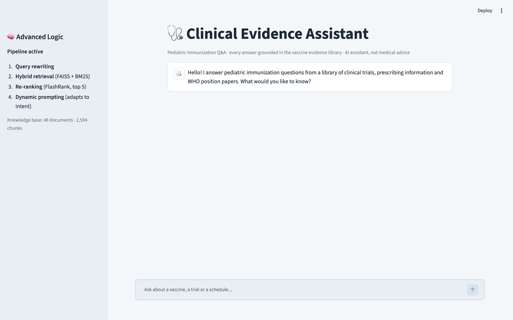
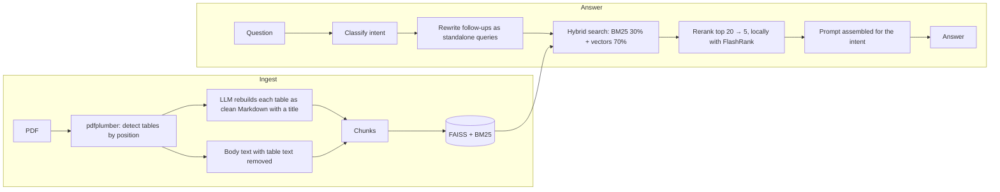

# Clinical Evidence Assistant

**Ask a clinical question, get an answer grounded in the trial data, with the numbers in a table.**

A RAG assistant over 48 pediatric vaccine documents (clinical trials, prescribing information,
systematic reviews, WHO position papers). It answers like a senior immunization specialist,
stays brand-neutral, and says when it is going beyond the documents.



## The problem I saw

Teams that work with clinical evidence need to know what the literature says about a vaccine,
and how an expert would respond to a claim. Asking a real specialist takes weeks and can't be
repeated every time the wording changes. Generic chatbots answer instantly but invent numbers.

The hard part is the documents themselves. Clinical PDFs carry their key data in tables:
efficacy by serotype, dosing schedules, adverse-event rates. Standard PDF extraction turns
those tables into scrambled text, so retrieval finds the right page and the model still
can't read the number.

## What I built



- **Tables survive ingestion.** Tables are found by their position on the page. An LLM rebuilds
  each one into a titled Markdown table, using the text just before it for context. The raw
  table text is removed from the body, so nothing is indexed twice. 591 of the 2,594 chunks
  are reconstructed tables.
- **Hybrid retrieval, then reranking.** Keyword search catches trial names and serotypes, and
  vector search catches meaning. A local cross-encoder keeps the best 5 of 20 at no API cost.
- **The prompt depends on the question.**
  - Data questions must answer with a table.
  - Questions about a specific child trigger a triage step: no recommendation until age,
    country and health status are known.
  - Every path is brand-neutral.
- **It flags what isn't in the documents.** If the answer isn't in the library, the reply
  starts by saying so.
- **Memory that doesn't grow without limit.** Older turns are summarised by a cheaper model
  once the history passes about 5,000 tokens.

## Run it

Python 3.11.

```sh
python -m venv .venv && source .venv/bin/activate
pip install -r requirements.txt
cp .env.example .env            # add your OpenRouter key
# put PDFs in data/ (see sources.md), then build the index once:
python run_ingest.py
streamlit run run_app.py
```

`python inspect_chunks.py` prints sample chunks, including the rebuilt tables.

## Layout

| Path | What it does |
|---|---|
| `src/data_ingestion/pdf_processor.py` | Table detection, LLM table reconstruction, text de-duplication |
| `src/data_ingestion/vector_store.py` | Chunking and FAISS index build/update |
| `src/retrieval/retrievers.py` | BM25 + FAISS ensemble with FlashRank reranking |
| `src/core/prompts.py` | Persona, intent routing and the modular prompt blocks |
| `src/core/agent.py` | Intent → rewrite → retrieve → generate |
| `src/ui/streamlit_app.py` | Chat interface showing the pipeline and the last query rewrite |

## Limits

- An AI assistant, not medical advice.
- The persona is a prompt, not a credential.
- Answers are only as current as the documents in `data/`.
- Table reconstruction uses an LLM, so a rebuilt table can contain errors. The source file
  and page are kept on every chunk so each table can be checked.
